


  <a href="#about">About</a> &nbsp;·&nbsp;
  <a href="#what-i-build">What I build</a> &nbsp;·&nbsp;
  <a href="#stack">Stack</a> &nbsp;·&nbsp;
  <a href="#how-i-work">How I work</a> &nbsp;·&nbsp;
  <a href="#lets-talk">Let’s talk</a>

 

## About

Hey, I’m **Elias Coto** — a software developer and AI designer from Costa Rica, building fast, accessible web products with AI and a modern TypeScript stack.

I help founders and teams turn ideas into fast, accessible web experiences — designed with AI, engineered with TypeScript, React and Next.js. I handle the whole process, from strategy and interface design to production code, so one person is accountable from the first idea to launch.



 

## What I build

<table>
  <tr>
    <td width="50%" valign="top">
      <h4><code>01</code>&nbsp; AI-Powered Product &amp; Interface Design</h4>
      AI-assisted exploration refined by hand into polished, accessible interfaces and reusable design systems.  
      UI DESIGN · UX DESIGN · DESIGN SYSTEMS
    </td>
    <td width="50%" valign="top">
      <h4><code>02</code>&nbsp; Web Design &amp; Development</h4>
      Fast, responsive sites with a distinctive design — built for performance, SEO and accessibility from the first line of code.  
      RESPONSIVE WEBSITES · LANDING PAGES
    </td>
  </tr>
  <tr>
    <td width="50%" valign="top">
      <h4><code>03</code>&nbsp; AI Integrations &amp; Automation</h4>
      Language models and automated workflows inside real products — assistants, structured outputs, webhooks and scheduled jobs, with validation and costs under control.  
      AI ASSISTANTS · WORKFLOW AUTOMATION
    </td>
    <td width="50%" valign="top">
      <h4><code>04</code>&nbsp; Full-Stack Web Apps &amp; MVPs</h4>
      Multi-user web apps and focused first versions — auth, roles, payments and dashboards, shipped in weeks on a foundation built to grow.  
      NEXT.JS · NODE.JS · POSTGRESQL
    </td>
  </tr>
</table>

 

## Stack

Picked for speed. Proven in production. Built to last. Every tile links to the official site.

  <b>CORE STACK</b> 
  <a href="https://www.typescriptlang.org"></a>
  <a href="https://nextjs.org"></a>
  <a href="https://react.dev"></a>
  <a href="https://nodejs.org"></a>
  <a href="https://www.postgresql.org"></a>

  <b>INTERFACE</b> 
  <a href="https://www.figma.com"></a>
  <a href="https://tailwindcss.com"></a>

  <b>AI AGENTS</b> 
  <a href="https://www.anthropic.com/claude-code">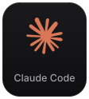</a>
  <a href="https://openai.com/codex"></a>

  <b>WORKFLOW &amp; AUTOMATION</b> 
  <a href="https://www.notion.so">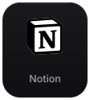</a>
  <a href="https://linear.app"></a>
  <a href="https://n8n.io"></a>
  

  <b>CODE &amp; DEPLOY</b> 
  <a href="https://github.com/EliasCotoGit">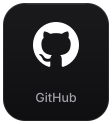</a>
  <a href="https://vercel.com">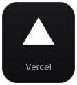</a>

 

## How I work

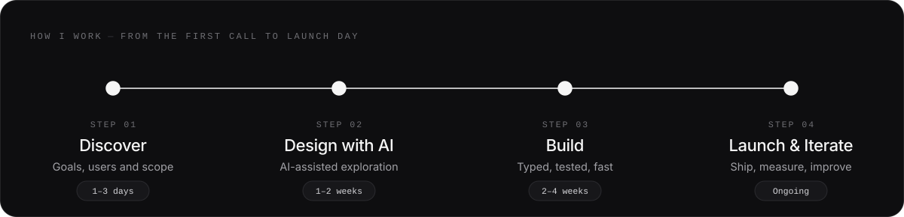

 

## Let’s talk


<a href="mailto:eliasazofeifa17@gmail.com"><b>eliasazofeifa17@gmail.com</b></a> &nbsp;·&nbsp; Costa Rica · GMT-6

<a href="#top">Back to top</a>

